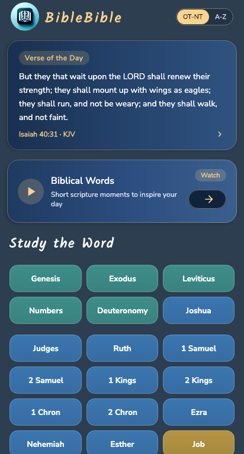
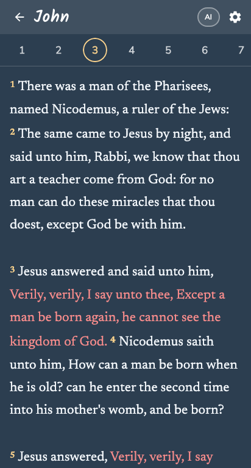
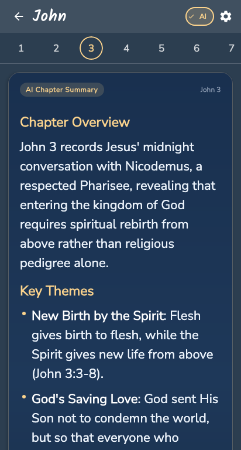
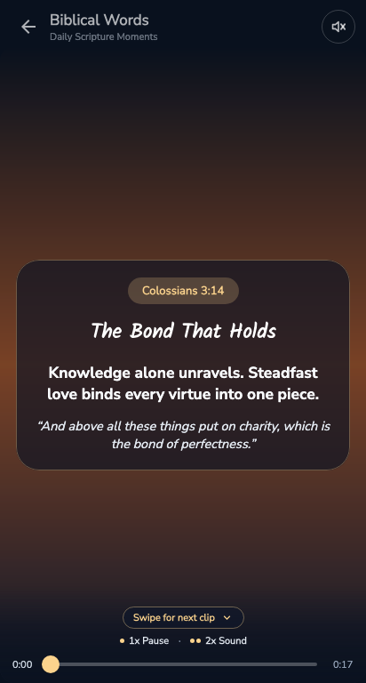
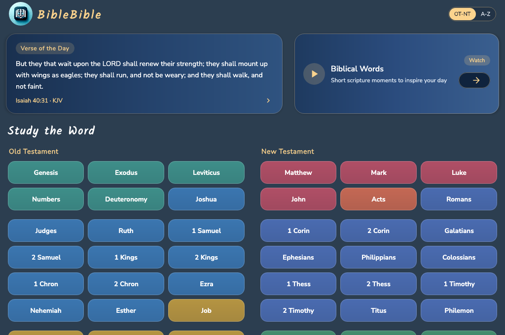
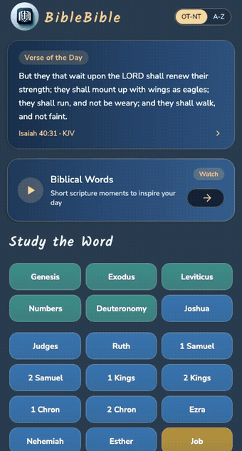

# BibleBible

A Kotlin Compose Multiplatform Bible reading app for **Android** (`3.1`), **iOS** (`5.8`), and **Desktop**, backed by a first-party Google Cloud Run gateway for public-domain scripture, Verse of the Day, Gemini AI chapter summaries, and curated `<30s` Biblical Words video devotionals.

Created by Kevin Phillips.

## Download

<p>
  <a href="https://apps.apple.com/us/app/my-biblebible/id6478799350">
    
  </a>
  &nbsp;
  <a href="https://play.google.com/store/apps/details?id=email.kevinphillips.biblebible">
    
  </a>
</p>

## Previews (`3.1` Android / `5.8` iOS)

| Home | Literary Bible Reader | Sticky AI Chapter Summary | Biblical Words |
| :---: | :---: | :---: | :---: |
|  |  |  |  |

### Adaptive Tablet & Landscape Layout

<p align="center">
  
</p>

### Animated Walkthrough (`3.1` / `5.8`)

<p align="center">
  
</p>

<p align="center">
  <a href="previews/biblebible-3.1-walkthrough.mp4">Download / view the MP4 walkthrough (456 KB)</a>
</p>

<details>
<summary>Earlier device walkthrough videos (Android &amp; iOS)</summary>

#### Android
https://github.com/phillipsk/BibleBible/assets/7585083/a41d07b4-9dd4-447c-a873-49963f12f51d

#### iOS
https://github.com/phillipsk/BibleBible/assets/7585083/af616ab8-ec06-4b2b-a58b-13e7cac5d439

</details>

## Highlights in `3.1` (Android) / `5.8` (iOS)

- **Biblical Words**: Vertical feed of **24 curated `<30s` scripture-centered devotional clips** with tap-to-pause, double-tap for sound, progress bar scrubbing, **Read Now** chapter jump links, unseen-clip shuffling, and smooth auto-advance.
- **Literary Bible Reader**: Bundled **Newsreader** serif typography with natural paragraph flow and Warm Coral (`#F48B8B`) red-letter Words of Jesus in supported translations, plus pinch-to-zoom, double-tap text sizing, lightweight Reading Tips, gold active chapter indicators, and a cleaner reader bar.
- **Sticky AI Chapter Summaries**: Keeps AI summary mode active as you swipe left or right through chapters within a book, with sanitized markdown formatting and wall-clock loading animations.
- **Verse of the Day & Home Experience**: Pull-to-refresh on Home (frosted gold arc indicator and smooth post-refresh sheen), customizable daily notification reminder times, direct verse jump links from notifications and the Home card, Home swipe gestures, a Reading History toggle in Settings, and adaptive layouts for foldables, landscape mode, and tablets.

## Architecture Overview

- **Zero Client-Side Secrets**: All scripture, Verse of the Day, AI summary, and Biblical Words requests route through the first-party Google Cloud Run gateway (`biblebible-api`) configured via `CLOUD_GATEWAY_URL` using short-lived HMAC session tokens. No third-party or LLM API keys are bundled into mobile binaries.
- **Public-Domain Translations**: Supports `KJV`, `BSB`, `WEB`, `BBE`, `RV1909` (Spanish), and `SVD` (Arabic, RTL), normalized with literary paragraph breaks and `wordsOfJesus` ranges and cached locally via SQLDelight.
- **Native Video Playback**: `ShortsVideoPlayer` uses hardware-accelerated **Media3 / ExoPlayer** (`TextureView`) on Android, **AVPlayer** (`AVPlayerLayer` with `AVAudioSessionCategoryPlayback`) on iOS, and a deterministic storyboard renderer on Desktop.
- **Simple State & Navigation**: Shared `@ThreadLocal` state objects (`BibleState`, `GeminiModel`, `CloudSessionManager`, `AnalyticsTracker`) drive animated screen transitions and deterministic state restoration without heavy third-party DI or navigation frameworks.

## Project Context & Agent Handoff

This repository maintains structured documentation so both human contributors and coding agents can pick up context quickly:

- [`AGENTS.md`](AGENTS.md): Permanent AI coding rules, conventions, security boundaries, and verification commands.
- [`docs/PROJECT_CONTEXT.md`](docs/PROJECT_CONTEXT.md): Long-term architectural baseline, module responsibilities, endpoints, and constraints.
- [`docs/HANDOFF.md`](docs/HANDOFF.md): Current release state, recent milestones, verified test results, and next steps.
- [`docs/mobile-test-release.md`](docs/mobile-test-release.md): Store release pipeline and GitHub Actions setup.
- [`docs/adr/`](docs/adr/): Architecture Decision Records (`0001` Cloud Gateway & Session Tokens, `0002` KMP vs. Native Video, `0003` Biblical Shorts Cloud Pipeline & Budget Cap, `0004` First-Party Cloud Analytics).

## Project Modules

- `/androidApp`: Android launcher module depending on `:composeApp` (Debug builds install side-by-side via `.debug` applicationId suffix).
- `/composeApp`: Shared Kotlin Multiplatform UI and data layers:
  - `commonMain`: Compose UI (`BibleHomeScreen`, `HomePullRefresh`, `VerseOfTheDayCard`, `BiblicalShortsEntryCard`, `BiblicalShortsScreen`, `BibleScripturesPager`, `BibleScriptures`, `GeminiSummary`, `LoadingScreen`), Ktor clients, SQLDelight database (`BibleBibleDatabase`), `CloudSessionManager`, `DailyVerseRepository`, `BiblicalShortsRepository`, `AnalyticsTracker`.
  - `androidMain`: Android entry point, SQLDelight Android driver, notification scheduling, Media3 `ShortsVideoPlayer`.
  - `iosMain`: iOS `ComposeUIViewController` bridge, SQLDelight native driver, `AVPlayer` `ShortsVideoPlayer`.
  - `desktopMain`: JVM Desktop Compose UI, SQLite driver, storyboard `ShortsVideoPlayer`.
- `/iosApp`: Xcode / SwiftUI host consuming `ComposeApp.framework`.
- `/backend` *(git-ignored, deployed directly to Google Cloud Run)*: Node.js 20 Cloud Run API (`biblebible-api`), HelloAO scripture normalization, Gemini summary gateway & sanitizer, 24-clip Biblical Words catalog with HTTP byte-range streaming, and analytics dashboard.

## Build and Test

Use **JDK 21** and **Android SDK 37**. Optional non-sensitive configuration in `local.properties` (git-ignored):

```properties
CLOUD_GATEWAY_URL=https://biblebible-api-687901748717.us-central1.run.app
AI_SUMMARIES_ENABLED=true
ENABLE_DIAGNOSTIC_LOGGING=false
```

```bash
# Build Android Debug APK & Desktop JAR
./gradlew :androidApp:assembleDebug :desktopApp:jvmJar

# Run shared KMP Desktop & Android host unit tests
./gradlew :composeApp:desktopTest :composeApp:testAndroidHostTest

# Verify zero secrets exist in tracked files
python3 tools/verify_no_client_secrets.py

# Cloud backend tests (untracked backend/ directory)
cd backend && npm test
```

See [`docs/build-modernization.md`](docs/build-modernization.md) and [`composeApp/README_TESTS.md`](composeApp/README_TESTS.md) for toolchain and testing details.
