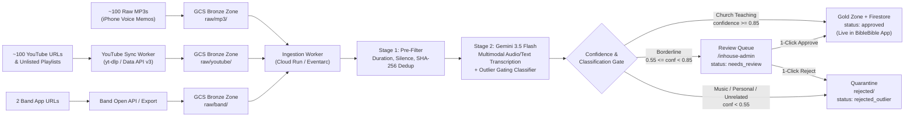

# BibleBible — "In-House Words" Church Content Data Lake & AI Ingestion Pipeline Plan

> **Document Purpose:** End-to-end architecture, data-cleaning specification, ingestion connectors, and operational runbook for BibleBible's second content pillar — **In-House Words** (church sermons, Bible studies, and morning prayers distilled into searchable biblical principles linked directly to scripture).
>
> **Audience:** Engineering leads & AI coding agents (Antigravity, Codex, Claude) evaluating, extending, or auditing the pipeline.

---

## 1. Product Vision: Two Complementary Pillars

| Pillar | Content Source | Creative Format | Cadence | Feature Flag |
| :--- | :--- | :--- | :--- | :--- |
| **Biblical Words** | Curated universal scripture lessons & modern parables | 9:16 vertical short videos (Veo 3.1 + Gemini TTS + synced 3-part narrative) | Static + periodic seasonal drops | `features.biblicalShortsEnabled` |
| **In-House Words** | Your church's own sermons, Bible studies, morning prayers, and Band devotionals | Structured biblical principle cards (key takeaway, scripture anchor, summary, source badge, and 1-tap **Read Chapter**) + optional future audio/video clips | Continuous weekly ingestion from MP3s, YouTube playlists, and Band | `features.inHouseWordsEnabled` |

---

## 2. Live Provisioned Infrastructure & MVP Status

The foundation is **already provisioned and deployed** in Google Cloud project **`gen-lang-client-0150678391`** (`us-central1`):

| Component | Status | Resource / Endpoint |
| :--- | :--- | :--- |
| **GCS Data Lake Bucket** | **LIVE** | `gs://gen-lang-client-0150678391-inhouse-words-lake` (`us-central1`, Uniform Bucket-Level Access, `roles/storage.objectAdmin` granted to Cloud Run SA) |
| **Cloud Run Gateway & Ingestion API** | **LIVE** | `https://biblebible-api-5jdy3d7zua-uc.a.run.app` |
| **Public App Feed Endpoint** | **LIVE** | `GET /v1/inhouse/words?category=All\|Sermon\|Bible%20Study\|Morning%20Prayer` |
| **AI Gating & Ingestion Endpoint** | **LIVE** | `POST /v1/inhouse/ingest` (accepts MP3 base64, YouTube URL + transcript/notes, or Band text/URL) |
| **Human Review Queue Endpoints** | **LIVE** | `GET /v1/inhouse/review-queue` and `POST /v1/inhouse/review/:id` (`approve` / `reject`) |
| **Hosted Admin & Upload Portal** | **LIVE** | `GET /inhouse-admin` (web portal to upload MP3s, paste YouTube/Band links, test outlier gating live, and 1-click approve/reject borderline items) |
| **Firestore Store** | **LIVE** | Collection `inHouseWords` (document-per-item with status `approved`, `needs_review`, or `rejected_outlier`) |
| **Mobile App UI (KMP)** | **LIVE** | Feature-flagged **In-House Words** entry card on Home + dedicated `InHouseWordsScreen` with category filters and **Read Chapter** deep-link into the Bible reader |

---

## 3. Google Cloud Data Lake Architecture (Medallion Pattern)

To cleanly separate noisy raw recordings from church-ready teachings, the GCS bucket follows a strict Medallion folder hierarchy:

```text
gs://gen-lang-client-0150678391-inhouse-words-lake/
├── raw/                          # Bronze Zone — immutable original uploads
│   ├── mp3/                      # ~100 iPhone Voice Memos (.mp3, .m4a, .wav)
│   ├── youtube/                  # Extracted captions/transcripts & metadata JSON from YouTube
│   └── band/                     # Exported Band posts, prayer requests, and devotional threads
├── staging/                      # Silver Zone — transcribed, normalized, SHA-256 deduplicated
│   └── transcripts/              # Full timestamped transcripts + acoustic/gating scores
├── curated/                      # Gold Zone — verified church teachings (also synced to Firestore)
│   └── approved/                 # Structured principle JSON ready for BibleBible mobile clients
└── rejected/                     # Quarantine Zone — filtered outliers (kept for audit, never served)
    ├── music_outliers/           # Choir/worship instrumentals or background music recordings
    └── unrelated_outliers/       # Personal memos, pocket dials, non-church conversations
```

### End-to-End Processing Flow



---

## 4. Multi-Stage Outlier Gating & Data Cleaning Pipeline

Because the ~100 raw MP3 files come directly from **iPhone Voice Memos**, they will inevitably include non-teaching outliers (e.g., church choir songs, piano practice, accidental pocket recordings, announcements, or personal voice notes). The pipeline enforces a **4-stage defense-in-depth gate**:

### Stage 1 — Deterministic Audio & Text Pre-Filter (Zero AI Cost)
- **Content-Hash Deduplication**: Compute SHA-256 of the audio bytes or canonical YouTube video ID / Band post ID so re-uploads never create duplicates.
- **Duration Guard**: Reject files `< 20 seconds` (pocket recordings / accidental taps) or empty/corrupt streams before calling Gemini.
- **Silence & Energy Ratio (`ffmpeg silencedetect`)**: Quarantine files that are `> 85%` silence or pure clipped static.
- **Speech-to-Music Acoustic Heuristic**: Flag recordings with sustained harmonic singing / high music-to-speech ratio for closer Stage 2 inspection.

### Stage 2 — Gemini Multimodal Classification & Extraction (`gemini-3.5-flash`)
Gemini natively processes both **raw MP3 audio** (up to 9.5 hours per file via Gemini File API or inline base64 for clips) and **YouTube/Band transcripts** in a single structured-JSON pass:
- **Classification Enum**:
  - `sermon` — Pastor preaching, Sunday message, topical biblical teaching
  - `bible_study` — Verse-by-verse study, small group discussion, midweek study
  - `morning_prayer` — Devotional prayer, intercession, morning meditation
  - `church_music_outlier` — Worship song, choir rehearsal, instrumental music without spoken teaching
  - `unrelated_outlier` — Personal voice memo, phone call, errands, announcements, non-scriptural chatter
- **Gating Rubric Signals**:
  1. Presence of coherent spoken biblical teaching, pastoral encouragement, or corporate prayer.
  2. Absence of purely musical/singing-only content (a 45-minute sermon with 3 minutes of intro singing is **kept** and trimmed to the spoken teaching; a 4-minute worship song recording is **rejected** as `church_music_outlier`).
  3. PII & Private Conversation Safety Check: If the recording contains private personal phone numbers, banking details, or private family disputes rather than public ministry teaching, force `rejected_outlier`.
- **Structured Principle Extraction** (only when classified as `sermon`, `bible_study`, or `morning_prayer`):
  - `title` (concise 4–9 words)
  - `category` (`Sermon` | `Bible Study` | `Morning Prayer`)
  - `keyPrinciple` (1–2 sentences distilling the core biblical truth)
  - `summary` (2–3 sentences of practical application)
  - `scriptureReference` (e.g. `Romans 8:28`, `Philippians 4:6-7`, `Psalm 23:1-4`)
  - `bookUsfm` (3-letter USFM code like `ROM`, `PHP`, `PSA`) & `chapter` (integer) — enables 1-tap **Read Chapter** directly inside BibleBible!
  - `tags` (3–5 topical tags)
  - `confidence` (`0.00` – `1.00`)
  - `gatingReason` (human-readable explanation of why it was approved, held, or rejected)

### Stage 3 — Corpus Coherence Check (Batch Phase 2)
When ingesting the initial 100 MP3s + 100 YouTube videos in bulk:
- Embed each transcript's summary (`text-embedding-004`).
- Compute cosine similarity against the church corpus centroid (anchored by verified pastor sermons & YouTube Bible studies).
- Any MP3 whose embedding distance exceeds `2.5σ` from the church teaching cluster is automatically downgraded to `needs_review` even if Stage 2 scored it `>= 0.85`.

### Stage 4 — Confidence Threshold Routing & Human-in-the-Loop
| Score / Classification | Status | Action |
| :--- | :--- | :--- |
| Teaching (`sermon` / `bible_study` / `morning_prayer`) AND `confidence >= 0.85` | `approved` | Published immediately to `GET /v1/inhouse/words` |
| Teaching AND `0.55 <= confidence < 0.85` (or Stage 3 cluster outlier) | `needs_review` | Held in `/inhouse-admin` Review Queue for 1-click Approve / Reject |
| `church_music_outlier`, `unrelated_outlier`, PII flag, or `confidence < 0.55` | `rejected_outlier` | Quarantined in `rejected/` — never shown in app |

---

## 5. Source Connectors & Exactly How to Share Your Content

### A. ~100 Raw MP3 Files (iPhone Voice Memos)
You can share them in whichever way is easiest for you — all three land directly in the same GCP Data Lake:

1. **Direct Bulk CLI Upload (Fastest for 100 files on Mac):**
   Export your Voice Memos folder to a local folder (e.g. `~/Desktop/Church-MP3s/`) and run:
   ```bash
   gcloud storage cp ~/Desktop/Church-MP3s/*.mp3 \
     gs://gen-lang-client-0150678391-inhouse-words-lake/raw/mp3/
   ```
   *(If Voice Memos export as `.m4a`, `gcloud storage cp` accepts `.m4a` too — Gemini processes both `.mp3` and `.m4a` natively, or FFmpeg converts them in 1 line.)*
2. **Hosted Web Uploader (Great for weekly 1-by-1 uploads):**
   Open `https://biblebible-api-5jdy3d7zua-uc.a.run.app/inhouse-admin`, drag-and-drop an MP3 (or paste notes), and immediately see the AI outlier gate + extracted principle.
3. **Google Drive Folder Sync (Optional):**
   Drop the 100 MP3s into a shared Google Drive folder and share the link; a 20-line Cloud Run sync job copies new files into `raw/mp3/` automatically.

### B. ~100 YouTube Links & Unlisted Playlists
- **Unlisted vs. Private Distinction (Important!):**
  - **Public & Unlisted YouTube videos/playlists require NO OAuth login or account credentials.** Just paste the playlist URL(s) or a `.txt`/`.csv` list of URLs!
  - **Private** videos (restricted to specific Google accounts) require a one-time YouTube Data API v3 OAuth2 refresh token stored in Google Secret Manager.
- **Recommended Bulk & Ongoing Connector (`yt-dlp` + YouTube Data API v3):**
  1. Enumerate playlist items: `yt-dlp --flat-playlist --dump-json "<PLAYLIST_URL>"` → yields stable `videoId`, `title`, `upload_date`, `duration`.
  2. Fetch captions first (fast & free): `yt-dlp --write-auto-subs --sub-lang en --skip-download`.
  3. If captions are missing or low-quality, download audio-only (`yt-dlp -f bestaudio -x --audio-format mp3`) to `raw/youtube/{videoId}.mp3` and transcribe with Gemini 3.5 Flash.
  4. POST extracted transcript/audio to `POST /v1/inhouse/ingest` with `sourceType: "youtube"` and `sourceUrl`.

### C. 2 Band App URLs (`band.us`)
- **Option 1 (Automated Ongoing — Band Open API):** Register a lightweight personal app at `developers.band.us`, store the read-only OAuth access token in Secret Manager (`BIBLEBIBLE_BAND_ACCESS_TOKEN`), and poll `GET https://openapi.band.us/v2/band/posts?band_key=...` daily via Cloud Scheduler.
- **Option 2 (Zero-API Immediate Start):** Copy/paste weekly devotional posts or export JSON from the 2 Band pages directly into `/inhouse-admin` (`sourceType: "band"`) or upload to `raw/band/`.

---

## 6. Ongoing Automated Orchestration (Phase 2)

Once the initial backfill (~100 MP3s + ~100 YouTube videos + 2 Band pages) is complete, ongoing updates run hands-free:

1. **Event-Driven MP3 Ingestion (GCS → Eventarc → Cloud Run):**
   Any new `.mp3` / `.m4a` dropped into `gs://gen-lang-client-0150678391-inhouse-words-lake/raw/mp3/` triggers an Eventarc `google.cloud.storage.object.v1.finalized` event that invokes `POST /v1/inhouse/ingest-gcs` on Cloud Run.
2. **Daily YouTube & Band Poller (Cloud Scheduler):**
   A daily Cloud Scheduler job (`0 7 * * * America/New_York`) checks configured YouTube playlist IDs and Band `band_key`s for unseen IDs, runs the gating pipeline, and publishes high-confidence teachings (or queues borderline ones for `/inhouse-admin` review).
3. **Batch Backfill CLI (`backend/scripts/ingest-inhouse-batch.mjs`):**
   Planned Phase 2 Node script that processes `gs://.../raw/mp3/*` and a `youtube-urls.txt` file with concurrency control (5 parallel Gemini File API jobs), resume checkpoints, and a summary CSV audit report.

---

## 7. Data Contract (`inHouseWords` Firestore Schema & Mobile API)

```json
{
  "id": "ihw_2026_11_20_a1b2c3",
  "title": "Walking in Peace Through Uncertainty",
  "category": "Sermon",
  "keyPrinciple": "True peace is not the absence of storms, but anchoring your anxious thoughts in thankful prayer before God.",
  "summary": "From Sunday's message on Philippians 4, we learn to replace spiraling worry with specific, grateful petitions, trusting God's peace to guard both heart and mind.",
  "scriptureReference": "Philippians 4:6-7",
  "bookUsfm": "PHP",
  "chapter": 4,
  "sourceType": "youtube",
  "sourceLabel": "Sunday Sermon",
  "sourceUrl": "https://youtube.com/watch?v=...",
  "tags": ["Peace", "Prayer", "Anxiety"],
  "status": "approved",
  "classification": "sermon",
  "confidence": 0.94,
  "gatingReason": "Clear pastoral exposition of Philippians 4:6-7 with practical devotional application.",
  "createdAt": "2026-11-20T15:00:00.000Z"
}
```

---

## 8. Cost Estimate & Security Guardrails

### Estimated Monthly Cost (GCP `gen-lang-client-0150678391`)
- **Initial Backfill (~100 MP3s @ avg 30 min + ~100 YouTube transcripts):**
  - GCS storage (~5 GB audio): **~$0.10 / month**
  - Gemini 3.5 Flash audio + text gating/extraction (~50 hours audio + 100 transcripts): **~$4 – $9 one-time**
  - Firestore reads/writes (<50k/mo): **Free tier ($0)**
- **Ongoing Weekly Cadence (2–5 new sermons/studies/prayers per week):**
  - **< $1.50 / month total** (well within the project's `$100/mo` budget cap).

### Security & Privacy Guardrails
- **Bucket Privacy:** `gs://gen-lang-client-0150678391-inhouse-words-lake` has **Public Access Prevention enforced** (never publicly browsable). Raw voice memos remain private in GCS; the mobile app only receives curated, structured text principles (and optional explicitly approved media).
- **Admin Endpoint Protection:** In Phase 2, protect `/v1/inhouse/ingest`, `/v1/inhouse/review-queue`, `/v1/inhouse/review/:id`, and `/inhouse-admin` with an `X-Admin-Secret` header (stored in Secret Manager) or Firebase Auth custom claim (`role: "church_admin"`).
- **Zero Secrets in Git:** `backend/` stays outside the frontend repository, and all API keys live in Google Secret Manager.

---

## 9. Agent Evaluation Checklist (For Antigravity / Codex Review)

When sharing this plan with another agent for critique or Phase 2 implementation, evaluate these specific engineering decisions:
1. **Large MP3 Handling (>20 MB):** Inline base64 works for short clips (<10 MB); for 45–60 minute sermons (30–60 MB), Phase 2 should upload via the **Gemini File API** (`POST /upload/v1beta/files`) or stream directly from GCS using **Vertex AI Gemini** (`gs://...` URI) so Cloud Run stays under 256 MB RAM.
2. **Long Sermon Multi-Principle Splitting:** Should a 50-minute sermon yield **1 primary principle** or **3–5 timestamped micro-principles** (chaptered takeaways)? Recommendation: extract 1 primary card + up to 3 secondary principle cards sharing the same `sourceId`.
3. **Outlier Recall vs. Precision:** Verify that `0.55–0.84` review-queue band prevents false-positive leaks of church music or personal voice memos while keeping pastor review effort under 5 minutes per week.
4. **Audio/Video Clip Playback (Phase 3):** Once principles are verified, should each In-House Words card optionally play the exact 30–60s audio highlight slice (`ffmpeg -ss START -to END`) from the original sermon?
